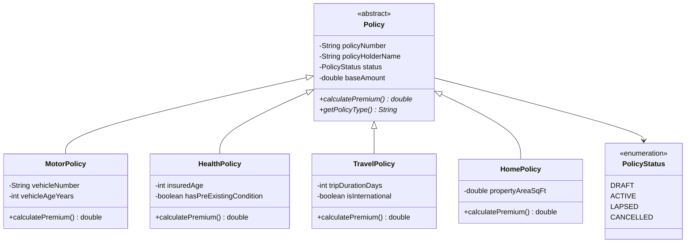

# Set 1: Insurance Policy Hierarchy – Class Diagram & OCP Rationale

## 1. Class Diagram (Mermaid)

## 2. Open/Closed Principle (OCP) Explanation
The Open/Closed Principle states that software entities should be open for extension, but closed for modification.
In this solution, when the new business line `HomePolicy` was requested:
- We did not touch or modify `Policy.java`, `MotorPolicy.java`, `HealthPolicy.java`, or `TravelPolicy.java`.
- We extended `Policy` by creating `HomePolicy` implementing `calculatePremium()`.
- The polymorphic reporting loop in `InsuranceHierarchyApp` processed the new policy seamlessly without requiring `instanceof` checks or `if-else` branching.
