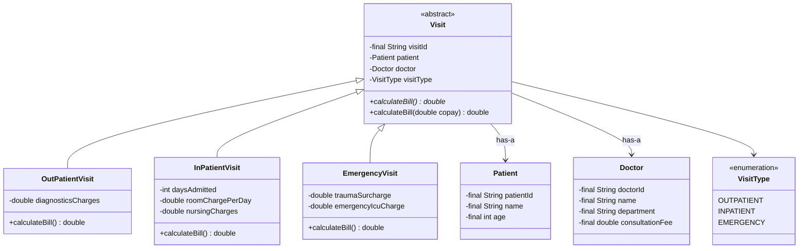

# Set 3: Hospital Billing Model – Inheritance Pitfall Analysis & Class Diagram

## 1. Class Diagram (Mermaid)

## 2. Inheritance Pitfall: Why `Doctor extends Patient` or `Patient extends Visit` is Flawed
- **The Misuse:** An amateur design might declare `class Patient extends Visit` to avoid writing composition getters.
- **Why It Breaks OO Principles:**
  1. A `Patient` is NOT a `Visit` (Liskov Substitution Principle violated).
  2. A patient can have 10 distinct visits over a year. Inheritance forces a 1-to-1 rigid compile-time bind.
  3. Patients have personal attributes (name, medical history, blood group), whereas visits model an episodic clinical billing transaction.
- **Composition Alternative:** `Visit` composes `Patient` (`private final Patient patient`).
