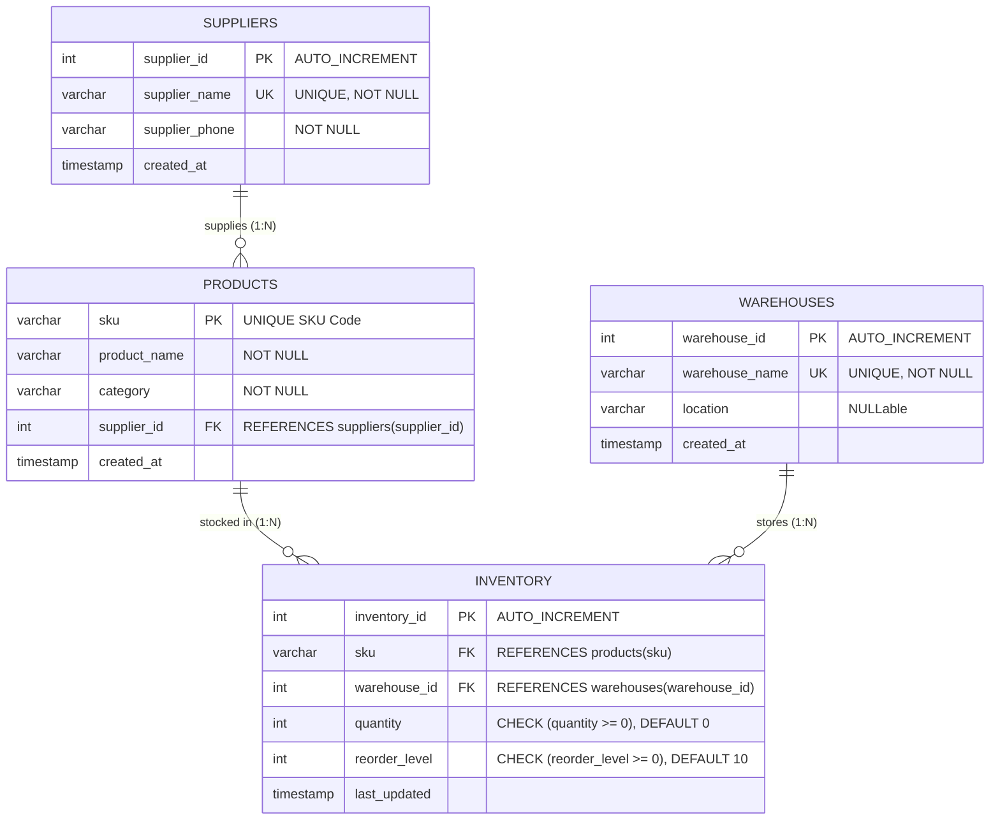

# Set 1 – Retail Inventory Management: Normalisation, ER Diagram & Anomalies Report

**Author:** Database Engineering Team  
**Database System:** MySQL 8.4 LTS (InnoDB Engine)  
**Schema:** `retail_inventory_db`

---

## 1. Initial Un-Normalised Spreadsheet Analysis

The original flat spreadsheet tracked retail inventory with the following columns:
$$\text{Spreadsheet}(\mathbf{SKU}, \text{product\_name}, \text{category}, \text{supplier\_name}, \text{supplier\_phone}, \mathbf{warehouse}, \text{quantity}, \text{reorder\_level})$$

Composite Candidate Key: `(SKU, warehouse)`

### Identified Anomalies in the Original Spreadsheet

1. **Insert Anomaly:**
   - A new supplier cannot be registered in the system unless they currently supply an active product that is stocked in at least one warehouse.
   - A new warehouse facility cannot be recorded until stock is moved into it for a particular SKU.
2. **Update Anomaly:**
   - If a supplier's contact telephone number changes (e.g., `Apex Electronics Ltd` updates phone), every single row listing products from that supplier across all warehouses must be updated. If even one row is missed, data becomes inconsistent.
   - If a product's name or category is modified, changes must be repeated across every warehouse storing that SKU.
3. **Delete Anomaly:**
   - If stock for a discontinued SKU is cleared out and deleted from all warehouses, the system accidentally destroys all records of the associated supplier and supplier phone number if that was the only product they supplied.

---

## 2. Normalisation to Third Normal Form (3NF)

### Step 1: First Normal Form (1NF)
- Ensure all attributes contain atomic (indivisible) values.
- Eliminate repeating groups.
- Establish a primary key: composite key `(SKU, warehouse)`.

### Step 2: Second Normal Form (2NF)
- Remove partial dependencies (where non-key attributes depend on only part of the composite primary key `(SKU, warehouse)`).
- **Functional Dependencies:**
  - `SKU -> product_name, category, supplier_name, supplier_phone` (Partial dependency on composite PK)
  - `warehouse -> warehouse_location` (Partial dependency on composite PK)
  - `(SKU, warehouse) -> quantity, reorder_level` (Full dependency)
- **Decomposition:**
  - Create separate relations for Product attributes and Stock/Inventory levels.

### Step 3: Third Normal Form (3NF)
- Remove transitive dependencies (where non-key attributes depend on other non-key attributes: $X \to Y$ and $Y \to Z$).
- **Transitive Dependency in Product:**
  - `SKU -> supplier_name -> supplier_phone`
  - Here, `supplier_phone` is transitively dependent on `SKU` through `supplier_name`.
- **Final 3NF Relations:**
  1. **`suppliers`** ($\underline{\text{supplier\_id}}$, supplier\_name, supplier\_phone)
  2. **`warehouses`** ($\underline{\text{warehouse\_id}}$, warehouse\_name, location)
  3. **`products`** ($\underline{\text{sku}}$, product\_name, category, $\text{supplier\_id}^*$)
  4. **`inventory`** ($\underline{\text{inventory\_id}}$, $\text{sku}^*$, $\text{warehouse\_id}^*$, quantity, reorder\_level)

---

## 3. Entity-Relationship (ER) Diagram



---

## 4. Failing-Insert Evidence & Verification

| Test # | Constraint Under Test | Failing SQL Statement | Expected Error Code & Message | Business Rule Protected |
| :---: | :--- | :--- | :--- | :--- |
| **1** | **Primary Key / UNIQUE** | `INSERT INTO products VALUES ('SKU-1001', 'Duplicate', 'Cat', 1);` | `ERROR 1062 (23000): Duplicate entry 'SKU-1001' for key 'products.PRIMARY'` | Prevents duplicate SKU codes in product catalog. |
| **2** | **Foreign Key Parent Check** | `INSERT INTO products VALUES ('SKU-9999', 'Ghost Widget', 'Cat', 999);` | `ERROR 1452 (23000): Cannot add or update a child row: a foreign key constraint fails` | Prevents orphan products without a valid registered supplier. |
| **3** | **CHECK Constraint** | `INSERT INTO inventory (sku, warehouse_id, quantity) VALUES ('SKU-1002', 3, -15);` | `ERROR 3819 (HY000): Check constraint 'chk_inventory_quantity' is violated.` | Enforces physical impossibility of negative warehouse stock. |
| **4** | **NOT NULL Mandatory Column** | `INSERT INTO suppliers (supplier_name, supplier_phone) VALUES (NULL, '+1-555-9999');` | `ERROR 1048 (23000): Column 'supplier_name' cannot be null` | Guarantees business identity is never blank. |

---

## 5. DML Update & Delete Evidence (Before & After)

### Scenario A: Correct Supplier Phone Number
- **Before UPDATE:**
  ```text
  +-------------+----------------------+----------------+
  | supplier_id | supplier_name        | supplier_phone |
  +-------------+----------------------+----------------+
  |           1 | Apex Electronics Ltd | +1-555-0101    |
  +-------------+----------------------+----------------+
  ```
- **UPDATE Executed:** `UPDATE suppliers SET supplier_phone = '+1-555-8888' WHERE supplier_id = 1;`
- **After UPDATE:**
  ```text
  +-------------+----------------------+----------------+
  | supplier_id | supplier_name        | supplier_phone |
  +-------------+----------------------+----------------+
  |           1 | Apex Electronics Ltd | +1-555-8888    |
  +-------------+----------------------+----------------+
  ```

### Scenario B: Decommission Discontinued SKU (`SKU-DISC-99`)
- **Before DELETE:**
  ```text
  +--------------+-------------+----------------------------------+----------+
  | inventory_id | sku         | product_name                     | quantity |
  +--------------+-------------+----------------------------------+----------+
  |           12 | SKU-DISC-99 | Old Generation Analog Thermostat |        5 |
  +--------------+-------------+----------------------------------+----------+
  ```
- **DELETE Executed:**
  ```sql
  DELETE FROM inventory WHERE sku = 'SKU-DISC-99';
  DELETE FROM products WHERE sku = 'SKU-DISC-99';
  ```
- **After DELETE:**
  ```text
  Empty set (0.00 sec) -- Confirmed removed from database without leaving orphan stock
  ```

---

## 6. System Databases & information_schema Query
Query executed against MySQL `information_schema.tables`:
```sql
SELECT table_name, engine, table_rows, data_length
FROM information_schema.tables
WHERE table_schema = 'retail_inventory_db';
```
Output:
```text
+-------------+--------+------------+-------------+
| TABLE_NAME  | ENGINE | TABLE_ROWS | DATA_LENGTH |
+-------------+--------+------------+-------------+
| inventory   | InnoDB |         11 |       16384 |
| products    | InnoDB |         11 |       16384 |
| suppliers   | InnoDB |         10 |       16384 |
| warehouses  | InnoDB |         10 |       16384 |
+-------------+--------+------------+-------------+
```
