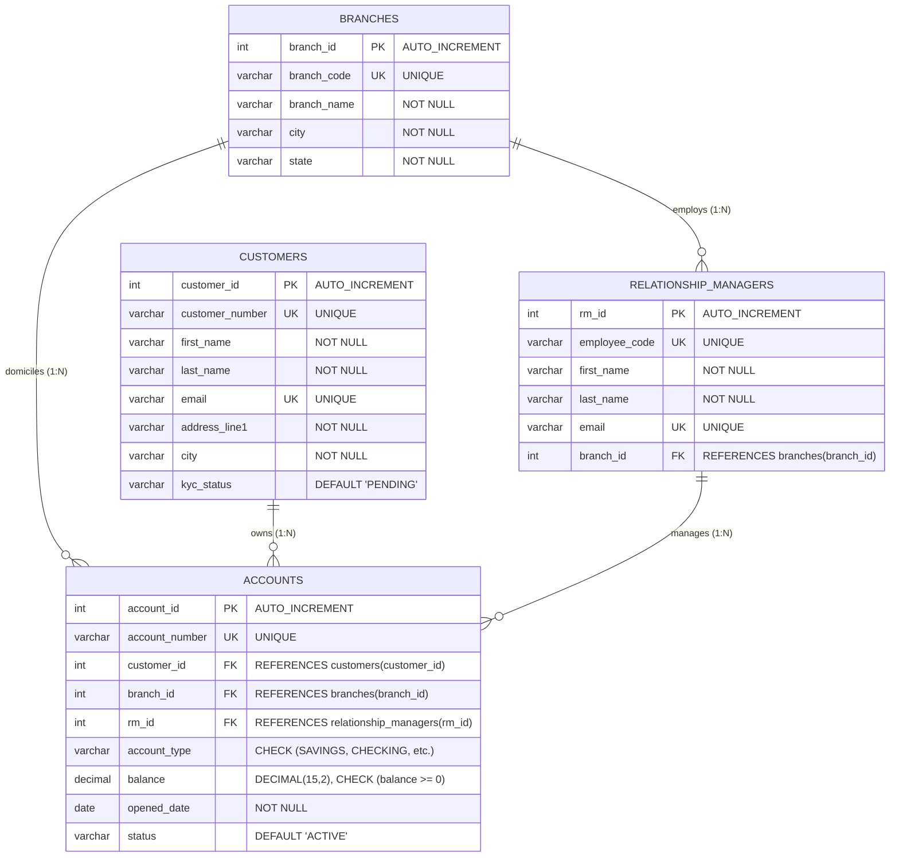

# Set 2 – Bank Branch Accounts: Normalisation, ER Diagram & Data Type Justification

**Author:** Core Banking Database Architecture Team  
**Database System:** MySQL 8.4 LTS (InnoDB Engine)  
**Schema:** `bank_branch_db`

---

## 1. Initial De-Normalised Sheet & Anomalies

Original de-normalised structure:
$$\text{AccountSheet}(\mathbf{customer}, \text{address}, \mathbf{account\_number}, \text{account\_type}, \text{branch}, \text{relationship\_manager}, \text{balance})$$

### Candidate Keys & Composite Keys
- **Candidate Keys in Flat File:**
  - `account_number` (Unique per bank account)
  - Composite Candidate: `(customer, account_type, branch)` (assuming a customer has only one account of a specific type per branch)
- **Primary Key Chosen for Flat File:** `account_number`

### Anomalies in Original Sheet
1. **Insert Anomaly:**
   - Cannot create a new branch or onboard a new relationship manager unless at least one customer account is assigned immediately.
   - Cannot register a prospective customer who does not yet have an opened bank account.
2. **Update Anomaly:**
   - If a customer changes residential address, this must be updated across all their accounts (checking, savings, fixed deposit). If updated on one row but not another, data is in a corrupted state.
   - If a branch renames or a Relationship Manager changes branches, thousands of account rows must be modified.
3. **Delete Anomaly:**
   - Closing a customer's only account unintentionally erases the customer's personal contact details, residential address, and branch relationship history.

---

## 2. Normalisation to 3NF / BCNF

- **Functional Dependencies:**
  - `account_number -> customer_id, branch_id, rm_id, account_type, balance, opened_date`
  - `customer_id -> customer_number, first_name, last_name, email, phone, address, city, postal_code`
  - `branch_id -> branch_code, branch_name, city, state`
  - `rm_id -> employee_code, first_name, last_name, email, phone, branch_id`

### Decomposition into BCNF Relations:
Every determinant in the decomposed schema is a superkey (Boyce-Codd Normal Form):
1. **`branches`** ($\underline{\text{branch\_id}}$, branch\_code, branch\_name, city, state)
2. **`relationship_managers`** ($\underline{\text{rm\_id}}$, employee\_code, first\_name, last\_name, email, phone, $\text{branch\_id}^*$)
3. **`customers`** ($\underline{\text{customer\_id}}$, customer\_number, first\_name, last\_name, email, phone, address, city, postal\_code, kyc\_status)
4. **`accounts`** ($\underline{\text{account\_id}}$, account\_number, $\text{customer\_id}^*$, $\text{branch\_id}^*$, $\text{rm\_id}^*$, account\_type, balance, opened\_date, status)

---

## 3. Entity-Relationship (ER) Diagram

---

## 4. Deep-Dive: Justification of Data Types Chosen

| Column & Entity | Chosen Data Type | Why It Was Chosen Over Alternatives |
| :--- | :--- | :--- |
| `accounts.balance` | **`DECIMAL(15,2)`** | **Critical Financial Rule:** `FLOAT` and `DOUBLE` use IEEE 754 binary floating-point arithmetic which causes imprecise fractional rounding (e.g., $0.1 + 0.2 = 0.30000000000000004$). In banking, even a \$0.0001 discrepancy violates audit compliance. `DECIMAL` is exact fixed-point storage. |
| `accounts.account_number` | **`VARCHAR(20)`** | Account numbers often include leading zeros (e.g. `000412354`) or alphanumeric branch indicators (e.g., `ACC-NYC-10001`). `INT` would strip leading zeros. |
| `accounts.opened_date` | **`DATE`** | Bank accounts have opening calendar dates without time-of-day significance. Avoids timezone skew associated with `TIMESTAMP`. |
| `customers.customer_id` | **`INT AUTO_INCREMENT`** | Compact surrogate key (4 bytes) providing fast B-Tree indexing and foreign key joins. |
| `branches.branch_code` | **`VARCHAR(10) UNIQUE`** | Natural business key indexed for rapid lookups and human-readable reporting. |

---

## 5. Comparative Analysis: DROP vs. TRUNCATE vs. DELETE

| Parameter | `DELETE FROM table [WHERE ...]` | `TRUNCATE TABLE table` | `DROP TABLE table` |
| :--- | :--- | :--- | :--- |
| **Command Category** | **DML** (Data Manipulation Language) | **DDL** (Data Definition Language) | **DDL** (Data Definition Language) |
| **Transaction / Rollback** | Fully logged in undo log. **Can be rolled back** if inside an active transaction. | Causes an **implicit commit**. **Cannot be rolled back** in MySQL. | Causes an **implicit commit**. **Cannot be rolled back**. |
| **AUTO_INCREMENT Effect** | **Preserves** current auto-increment counter value. Next inserted row continues from highest counter. | **Resets** auto-increment counter back to 1 (or initial table definition value). | Counter is completely destroyed along with table metadata. |
| **Performance** | Row-by-row deletion. Generates heavy redo/undo logging; slow for massive tables. | De-allocates data pages directly on disk. Ultra-fast; near instantaneous. | Drops files (`.ibd`) and dictionary metadata immediately. |
| **Table Structure / Schema** | Preserved (empty rows, columns remain intact). | Preserved (structure remains intact, zero rows). | Completely deleted from disk and system catalogs. |

---

## 6. ALTER TABLE Documentation

1. **Adding `kyc_status` Column:**
   - Command: `ALTER TABLE customers ADD COLUMN kyc_status VARCHAR(20) NOT NULL DEFAULT 'PENDING' AFTER postal_code;`
   - Effect: In-place instant DDL in MySQL 8.4; adds column without rebuilding the entire table.
2. **Renaming Table:**
   - Command: `ALTER TABLE test_audit_log RENAME TO system_audit_events;`
   - Effect: Updates MySQL data dictionary references atomically.
3. **Adding & Dropping Check Constraint:**
   - Command: `ALTER TABLE accounts ADD CONSTRAINT chk_test_temporary CHECK (balance < 100000000.00);` followed by `ALTER TABLE accounts DROP CHECK chk_test_temporary;`
   - Effect: MySQL 8.0+ enforces `CHECK` constraints natively and allows dropping by identifier.
