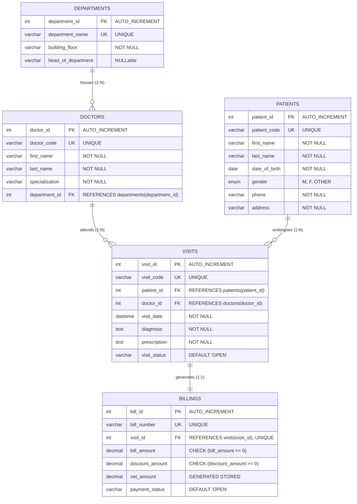

# Set 3 – Hospital Patient Records: Normalisation, ER Diagram & SQL vs NoSQL Comparison

**Author:** Healthcare Systems Database Architecture Team  
**Database System:** MySQL 8.4 LTS (InnoDB Engine)  
**Schema:** `hospital_records_db`

---

## 1. Initial Flat Sheet Analysis & Decomposition to 3NF

### The Original Wide Sheet:
$$\text{WideSheet}(\text{patient}, \text{address}, \text{doctor}, \text{department}, \text{visit\_date}, \text{diagnosis}, \text{prescription}, \text{bill\_amount})$$

Candidate Key: `(patient, doctor, visit_date)`

### Anomalies in the Wide Sheet:
1. **Insert Anomaly:**
   - A new doctor or medical department cannot be added to the system unless a patient has already visited that doctor.
   - A new patient profile cannot be created in hospital records without immediately billing a clinical visit.
2. **Update Anomaly:**
   - If a doctor changes their name, phone, or department, every past historical visit record must be updated. Missing even one row creates duplicate physician identities.
   - If a patient relocates and updates their address, updating past records can cause inconsistency.
3. **Delete Anomaly:**
   - If a patient's historical visit record is deleted, all information regarding that hospital department or newly appointed doctor is permanently erased if no other visits exist for them.

---

## 2. Step-by-Step 3NF Decomposition

### Step 1: First Normal Form (1NF)
- Eliminate multivalued attributes (e.g. compound diagnosis or multi-medication text into discrete columns or normalized junction tables).
- All column values must be atomic.
- Primary key chosen: `(patient_id, doctor_id, visit_date)`.

### Step 2: Second Normal Form (2NF)
- Eliminate partial dependencies on the composite key:
  - `patient_id -> patient_name, address, phone, dob` (Independent of doctor or visit date)
  - `doctor_id -> doctor_name, department` (Independent of patient or visit date)
- **Decompose into:** `patients`, `doctors`, and `visits`.

### Step 3: Third Normal Form (3NF)
- Eliminate transitive dependencies (non-key attribute determining another non-key attribute):
  - In `doctors`: `doctor_id -> department_name -> building_floor, head_of_department`
  - Transitive dependency: `department_name` determines department metadata.
  - In `visits`: `visit_id -> bill_amount, discount, payment_status` (Separated into a distinct 1:1 / 1:N billing entity for financial audit decoupling).
- **Resulting 3NF Relations:**
  1. **`departments`** ($\underline{\text{department\_id}}$, department\_name, building\_floor, head\_of\_department)
  2. **`patients`** ($\underline{\text{patient\_id}}$, patient\_code, first\_name, last\_name, date\_of\_birth, gender, phone, address)
  3. **`doctors`** ($\underline{\text{doctor\_id}}$, doctor\_code, first\_name, last\_name, specialization, phone, $\text{department\_id}^*$)
  4. **`visits`** ($\underline{\text{visit\_id}}$, visit\_code, $\text{patient\_id}^*$, $\text{doctor\_id}^*$, visit\_date, diagnosis, prescription, visit\_status)
  5. **`billings`** ($\underline{\text{bill\_id}}$, bill\_number, $\text{visit\_id}^*$, bill\_amount, discount\_amount, net\_amount, payment\_status)

---

## 3. Entity-Relationship (ER) Diagram

---

## 4. What Happens to Files on Database & Table Lifecycle in MySQL 8.4

### 1. `CREATE DATABASE hospital_sandbox_temp;`
- In MySQL 8.0/8.4 LTS, the server creates a physical subdirectory under the data directory (`datadir`), named `hospital_sandbox_temp/`.
- System dictionary tables in the shared InnoDB tablespace (`mysql.ibd`) are updated with the database schema metadata and default collation.

### 2. `ALTER TABLE billings RENAME TO patient_invoices;`
- For InnoDB tables with `file-per-table` enabled (default `innodb_file_per_table = ON`), MySQL renames the underlying tablespace file on disk from `billings.ibd` to `patient_invoices.ibd`.
- Data dictionary metadata is atomically updated in `mysql.ibd`. No actual table rows are copied or rewritten, making table renames practically instantaneous.

### 3. `DROP DATABASE hospital_sandbox_temp;`
- MySQL unlinks and deletes all `.ibd` tablespace files contained within the database folder.
- Deletes the physical directory from the filesystem.
- Metadata and access privileges associated with that database are purged from MySQL data dictionary.
- **Warning:** `DROP DATABASE` is irreversible and cannot be rolled back.

---

## 5. SQL (Relational) vs. NoSQL (Document) Comparison for Hospital Patient Records

| Comparison Dimension | Relational Database (MySQL 8.4 LTS / InnoDB) | Document NoSQL (e.g., MongoDB / Couchbase) |
| :--- | :--- | :--- |
| **Structure & Schema** | **Rigid, Structured Schema:** Normalized into 5 tables connected via Primary/Foreign Keys. Column types and constraints strictly enforced at DB level. | **Flexible, Dynamic JSON/BSON:** Entire visit, prescription, and billing can be embedded in a single polymorphic patient document without upfront schema. |
| **Consistency Model** | **ACID Compliant:** Immediate consistency. Guarantees banking and medical regulatory audit compliance (HIPAA / NABH). Zero dirty reads. | **BASE Model / Tunable Consistency:** Eventual consistency common. Strong consistency supported on single documents, but multi-document transactions carry distributed overhead. |
| **Scalability** | **Vertical Scaling (Scale-Up):** Highly optimized for multi-table JOINs, indexing, and high write concurrency on single/replicated instances. | **Horizontal Scaling (Scale-Out):** Native sharding across clusters. Ideal for massive unstructured clinical telemetry and imaging archives. |
| **Typical Healthcare Use Case** | Core EHR/EMR patient master records, hospital pharmacy inventory, financial billing, insurance claim reconciliation. | IoT patient wearable monitoring logs, diagnostic telemetry streams, telemedicine chat logs, unstructured doctor clinical notes. |
| **Trade-offs** | Requires complex multi-table JOINs for comprehensive patient view, but guarantees zero redundant data. | Fast single-document lookups without JOINs, but redundant patient address updates require updating millions of nested documents. |
